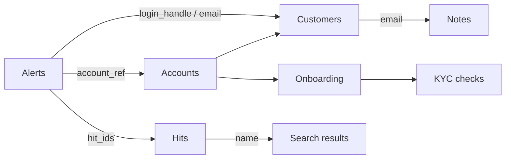

# Is my customer sanctioned?

Screening compares each customer with sanctions, PEP, enforcement and adverse media lists. When a name looks similar it raises an **alert**. Each alert has one or more **hits**, which are list profiles that might be the customer.

**Goal:** build a system that decides, for every hit, whether it is the customer.

| Dataset | Count |
|---|---|
| Development alerts | 379 |
| Hits to decide | 766 |
| Customer records | 71,865 |
| Practice labels | 50 |
| Unseen set | Held back |

---

## What is name screening?

**Identity, not policy: is the hit the customer?**

A payments company screens every customer against sanctions, PEP, enforcement and adverse media lists. When a name looks similar, an alert is raised, and an analyst decides whether the listed profile really is the customer or just someone with a similar name. How serious the listing is, and whether the customer would still be acceptable, do not matter here. Only identity matters.

### The three decisions

| Decision | Meaning |
|---|---|
| `DIFFERENT_ENTITY` | The evidence shows the hit is a different person or company. The hit is cleared. |
| `SAME_ENTITY` | The evidence shows the hit is the customer. The alert goes to the compliance team. |
| `REVIEW` | The evidence cannot settle it. A person looks at it. |

- An alert is cleared only when **every** hit in it is `DIFFERENT_ENTITY`.
- Clearing a hit that is the customer is **the worst mistake**.
- **When in doubt, `REVIEW`.**

---

## The challenge

The customer is spread over the bank's systems, and the hit's facts can be in any of them.

### 1. Know who the customer is first

The customer's full picture is spread over:

- the system of record
- accounts
- onboarding
- the KYC provider
- the support tool

These systems do not share one key.

- Follow whatever link the alert carries.
- If there is no link, find the records that fit what was screened.
- **Never use another customer's records.**

### 2. One person, one picture

- Records that share a **phone number and the same full date of birth** belong to the same person.
- A shared phone or address **alone does not** link records, because family members often share them.
- If several people fit an alert and they lead to different decisions, the decision is `REVIEW` with `AMBIGUOUS_CUSTOMER_RECORD`.

### 3. Verified beats declared

- The **most recent approved** identity check is the most reliable source for legal name, date of birth and document country.
- Rejected or expired checks are **not** evidence.

### 4. Gather the hit's facts wherever they are

A hit's date of birth may be:

- in its `dobs` field
- in a sentence of its profile notes
- only in web search results, most of which are about namesakes

### 5. Names are messy

Compare name parts:

- ignoring case, accents, punctuation and brackets
- allowing name variants (Muhammad / Mohammed / Mohamed)
- allowing parts written together or apart
- allowing small spelling edits

Also:

- Aliases and nicknames count.
- Placeholders such as `NA`, `TEST` or `UNKNOWN` are **not** name parts.

---

## When to clear, when to confirm

These rules come from Diligent's screening SOP (`POLICY.md`, in the data).

### Clear only on a contradiction

| Check | Clears the hit when… |
|---|---|
| **Time** | The customer was younger than 16 at the earliest dated report, **or** a company was incorporated after it, **or** the profile gives a date of death before the customer was screened. |
| **Date of birth** | The customer's birth year is more than 1 year outside every birth year the hit gives, **or** both give a month in the same year and the months or days differ. |
| **Location** | Every country tied to the customer differs from every country tied to the hit. ⚠️ A country difference does **not** clear a hit whose name and date of birth agree. That case is `REVIEW`. |
| **Name** | The customer's verified legal name agrees with none of the hit's names or aliases. |
| **Type** | One is a person and the other is a company. |

### Confirm only on agreement

- **Person:** confirm when name **and** date of birth agree and nothing contradicts them.
- **Company:** confirm when name **and** country agree and nothing contradicts them.
- Otherwise: `REVIEW`.

---

## Reason codes

For each hit, give:

1. the main reason, as **one code that belongs to the decision**
2. the **IDs of the records** the reason rests on
3. the **customer record it resolved** (`null` if none was found)

| Decision | Reason code | Use it when |
|---|---|---|
| `DIFFERENT_ENTITY` | `TEMPORAL_IMPOSSIBILITY` | The customer was too young, or not yet incorporated, at the earliest dated report |
| `DIFFERENT_ENTITY` | `DOB_MISMATCH` | The customer's date of birth (or a company's incorporation date) contradicts every birth date the hit gives |
| `DIFFERENT_ENTITY` | `LOCATION_MISMATCH` | Every country tied to the customer differs from every country tied to the hit |
| `DIFFERENT_ENTITY` | `NAME_MISMATCH_VERIFIED` | The customer's verified legal name does not agree with any of the hit's names |
| `DIFFERENT_ENTITY` | `ENTITY_TYPE_MISMATCH` | One is a person and the other is a company |
| `DIFFERENT_ENTITY` | `DECEASED` | The hit's profile gives a date of death before the customer was screened |
| `SAME_ENTITY` | `NAME_DOB_LOCATION_MATCH` | Name, date of birth and country all agree and nothing contradicts them |
| `SAME_ENTITY` | `NAME_DOB_MATCH` | Name and date of birth agree and nothing contradicts them |
| `SAME_ENTITY` | `NAME_LOCATION_MATCH` | Companies only: name and country agree and nothing contradicts them |
| `REVIEW` | `INSUFFICIENT_DATA` | Nothing settles it: no contradiction, and not enough agreement to confirm |
| `REVIEW` | `AMBIGUOUS_CUSTOMER_RECORD` | More than one person in the system of record fits the alert and they lead to different decisions |

---

## The data

There is a development set to build on and an unseen set you never see.

- The system reads the **JSON Lines files in the `dev/` folder** of the data room. These files are the **source of truth**. The unseen set comes in the same format.
- The workbook (`Screening Dev Set - browse.xlsx`) is a read-only view of the development set for browsing. It has no answers, except for **50 practice labels** that show the path through the files to each answer.

| Tab | Rows | What it is |
|---|---|---|
| Alerts | 379 | One row per screening alert: the customer as screened, the link to the customer if the alert has one, and the hit IDs |
| Hits | 766 | One row per watchlist profile that matched. **Decide each of these.** |
| Customers | 71,865 | The bank's system of record |
| Accounts | 86,227 | Links from account numbers and logins to customers, and from accounts to KYC applicants |
| Onboarding | 71,865 | (as above) |
| KYC checks | 53,977 | Identity checks by the KYC provider, keyed by applicant ID |
| Notes | 31,675 | Support and onboarding notes, filed by the customer's email |
| Search results | 16,791 | Web search results by name. Most are about namesakes. |
| Practice labels | 50 | Answered hits, with the path through the files to the answer |
| Policy | – | The SOP (`POLICY.md`) and the name variants (`name_variants.json`) |

### How the tabs link

```
Alerts.hit_ids        → Hits.hit_id
Alerts.account_ref    → Accounts → Customers
Alerts.login_handle   → Customers
Alerts.email          → Customers
Accounts              → Onboarding → KYC checks
Customers.email       → Notes
Hit name              → Search results
```



---

## Deliverable (from "Screening — Brief v3")

- **Runnable system:** `system/run <data folder> <output file>`.
  - Reads only that folder. Writes one JSON line per hit.
  - **Python 3 or Node.js standard library only**, or shell.
  - LLM calls are allowed **only through OpenRouter**, with the key in `OPENROUTER_API_KEY`.
  - A run must take **under 30 minutes**.
- **Predictions:** `output/dev.jsonl`, made by the system.
- **README:** `system/README.md`. It covers:
  - the architecture (with a diagram)
  - how we resolve the customer and the listed person
  - how we represent evidence
  - how we keep results the same from run to run
  - the model and prompts, if any
  - the time and cost of a run
  - three worked cases: a clear mismatch, a match, and one left for review
- **Submit:** a public GitHub repo with `system/` and `output/`. **Don't commit the `dev/` data or the API key.**

### Output line

| Field | Content |
|---|---|
| `hit_id`, `alert_id` | Which hit, from `hits.jsonl` |
| `decision` | `DIFFERENT_ENTITY`, `SAME_ENTITY` or `REVIEW` |
| `reason_code` | The main ground, from the POLICY.md table |
| `customer_record_id` | The resolved customer record, `AMBIGUOUS` if more than one person fits, or `null` |
| `reason` | Two to four sentences naming the decisive facts |
| `evidence` | The IDs of the records that decided it, exactly as they appear in the files |

### Data room files

`POLICY.md`, `alerts.jsonl`, `hits.jsonl`, `customers.jsonl`, `accounts.jsonl`, `onboarding.jsonl`, `kyc_checks.jsonl`, `notes.jsonl`, `search_results.jsonl`, `name_variants.json`, `practice_labels.jsonl`, `validate.py`.

The official files are in `dev/`, and the organisers' `validate.py` and `output.schema.json` are at the repo root. The full official brief is `OFFICIAL_README.md`.

### Rules from the brief

- **Unknown stays unknown.** A missing field, or the missing part of a partial date, is not a mismatch.
- **Verified beats declared.**
- **Build for the principles, not these files.** The unseen set has new customers, new hits, and free text worded differently.

## Scoring

The system is run **5 times on an unseen set of about 550 hits**, plus once on the dev set.

### Cost per decision (lower is better)

| Right answer ↓ / You said → | `DIFFERENT_ENTITY` | `SAME_ENTITY` | `REVIEW` |
|---|---|---|---|
| `DIFFERENT_ENTITY` | 0 | 3 | 3 |
| `SAME_ENTITY` | **60** (unsafe clearance) | 0 | 2 |
| `REVIEW` | **60** (unsafe clearance) | 2 | 0 |

- The decision score is the share of cost saved compared with sending everything to `REVIEW`. That baseline scores 0, and so does clearing everything.
- Clearing a hit gains 3 when right and loses about 58 when wrong. So a clearance only pays off when we are at least **about 95% sure**.
- Choosing between `SAME_ENTITY` and `REVIEW` breaks even at 50%.
- Some hits aren't scored, because their answer depends on information that isn't in the files.

### Reason checks

These are checked for every correct decision:

- the reason code fits
- the evidence cites the records that decided it, not everything we looked at
- the customer record is right
- the reason states the real grounds, using this hit's own facts

### Weights (out of 100)

| Part | Weight | What counts |
|---|---|---|
| Unseen set | 80% | Decisions 75%, reasons 25% |
| Dev set | 10% | Decisions 75%, reasons 25% |
| Reproducibility | 10% | Same decision and reason code in all 5 runs, scaled by the unseen score |

Finalists' judges read the README and ask about four things:

- how we resolve people on both sides
- how we represent evidence
- how we stay deterministic
- whether the explanations are honest about what's missing
